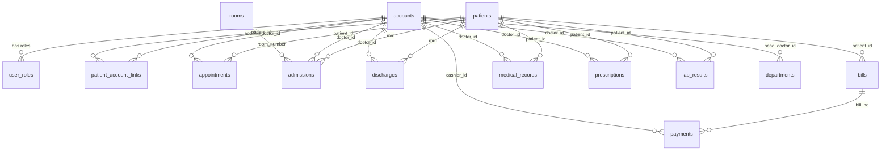

# Third Normal Form (3NF) Database Normalization Report

**System:** MediCore Hospital Records System / West Metro Medical Center  
**Date:** November 11, 2026  
**Status:** Completed & Verified  

---

## Executive Summary

The database was audited and migrated to **Third Normal Form (3NF)**. In 3NF:
1. Every table is in 1NF (atomic columns, no repeating groups).
2. Every table is in 2NF (no partial dependencies on composite keys).
3. Every table is in 3NF (no transitive dependencies; every non-key column depends solely and directly on the primary key, and nothing else).

All 21 database tables were analyzed. 7 tables already complied with 3NF. The remaining 14 tables were normalized to eliminate duplicated names, redundant composite strings, and computed fields, replacing transitive dependencies with relational foreign keys (`patient_id`, `doctor_id`, `cashier_id`, `head_doctor_id`).

All existing data was preserved without loss or duplication. Historical snapshots (`bills.patient_address`, `address_history`, `audit_logs`) were intentionally retained as sanctioned audit records.

---

## 1. Table-by-Table: BEFORE vs. AFTER & WHAT FOR

Below is the side-by-side comparison for each changed table, along with a plain-language explanation of the problem prevented.

### 1. `accounts` (User Accounts)
* **BEFORE (Columns):** `id`, `user_id`, `username`, `password_hash`, `email`, `role`, `user_role_label`, `status`, `last_login`, `full_name`, `department`, `specialty`, `license_number`, `birthdate`, `phone`, `avatar`, `created_at`, `force_password_change`, `set_password_token`, `set_password_expires_at`, `country`, `province`, `city`, `barangay`, `street`, `postal_code`, `sex`, `phone_verified`, `address`
* **AFTER (Columns):** `id`, `user_id`, `username`, `password_hash`, `email`, `role`, `status`, `last_login`, `full_name`, `department`, `specialty`, `license_number`, `birthdate`, `phone`, `avatar`, `created_at`, `force_password_change`, `set_password_token`, `set_password_expires_at`, `country`, `province`, `city`, `barangay`, `street`, `postal_code`, `sex`, `phone_verified`
* **WHAT FOR:** Dropped `address` and `user_role_label` because they duplicated information already stored in the specific address components and role tables, preventing out-of-sync address text and conflicting role labels.

---

### 2. `patients` (Master Patient Directory)
* **BEFORE (Columns):** `id`, `patient_id`, `mrn`, `registration_status`, `first_name`, `middle_name`, `last_name`, `full_name`, `birthdate`, `phone`, `email`, `insurance_no`, `avatar`, `sex`, `blood_type`, `address`, `country`, `province`, `city`, `barangay`, `street`, `postal_code`, `phone_verified`, `id_checked`, `consent_given`, `status`, `created_by`, `created_at`, `upgraded_by`, `upgraded_at`, `no_phone`, `contact_name`, `contact_relationship`, `contact_phone`, `contact_first_name`, `contact_middle_name`, `contact_last_name`, `contact_relationship_other`
* **AFTER (Columns):** `id`, `patient_id`, `mrn`, `registration_status`, `first_name`, `middle_name`, `last_name`, `birthdate`, `phone`, `email`, `insurance_no`, `avatar`, `sex`, `blood_type`, `country`, `province`, `city`, `barangay`, `street`, `postal_code`, `phone_verified`, `id_checked`, `consent_given`, `status`, `created_by`, `created_at`, `upgraded_by`, `upgraded_at`, `no_phone`, `contact_relationship`, `contact_phone`, `contact_first_name`, `contact_middle_name`, `contact_last_name`, `contact_relationship_other`
* **WHAT FOR:** Dropped redundant composite strings (`full_name`, `address`, and `contact_name`) so that updating a name or street address only ever has to be changed in one single place without causing data discrepancies.

---

### 3. `patient_account_links` (Patient Portal Profile Links)
* **BEFORE (Columns):** `id`, `account_uid`, `patient_id`, `mrn`, `patient_name`, `relationship_label`, `is_primary`, `linked_at`, `linked_by`, `unlinked_at`
* **AFTER (Columns):** `id`, `account_uid`, `patient_id`, `relationship_label`, `is_primary`, `linked_at`, `linked_by`, `unlinked_at`
* **WHAT FOR:** Dropped copied patient names and MRNs from account link rows so that whenever a patient's name is updated or corrected, all linked family accounts instantly reflect the correct name via the `patient_id` foreign key.

---

### 4. `roles` (System Security Roles)
* **BEFORE (Columns):** `id`, `role_name`, `description`, `user_count`, `permissions_json`, `icon`
* **AFTER (Columns):** `id`, `role_name`, `description`, `permissions_json`, `icon`
* **WHAT FOR:** Removed the hardcoded `user_count` column so the displayed user count is always accurately calculated from active accounts rather than becoming inaccurate when users are added or removed.

---

### 5. `departments` (Clinical & Hospital Departments)
* **BEFORE (Columns):** `id`, `name`, `head_doctor`, `staff_count`, `location`
* **AFTER (Columns):** `id`, `name`, `head_doctor_id`, `location`
* **WHAT FOR:** Stored the doctor's account ID (`head_doctor_id`) instead of typing their name directly and dropped `staff_count`, ensuring department head names always update automatically if a doctor changes their name and staff headcounts are always accurate.

---

### 6. `rooms` (Hospital Rooms & Beds)
* **BEFORE (Columns):** `id`, `room_number`, `ward`, `status`, `patient_name`
* **AFTER (Columns):** `id`, `room_number`, `ward`, `status`
* **WHAT FOR:** Removed the copied patient name from the room table so that room occupancy is determined directly by active admissions, preventing "ghost" patients from remaining listed on rooms after discharge.

---

### 7. `appointments` (Scheduled Doctor Consultations)
* **BEFORE (Columns):** `id`, `patient_id`, `slot_time`, `patient_name`, `visit_type`, `status`, `complaint`, `doctor_name`, `department`, `appt_date`
* **AFTER (Columns):** `id`, `patient_id`, `slot_time`, `visit_type`, `status`, `complaint`, `doctor_id`, `department`, `appt_date`
* **WHAT FOR:** Replaced copied patient and doctor names with direct foreign keys (`patient_id`, `doctor_id`), so appointments always link to the real patient and doctor records even if either party's profile name changes.

---

### 8. `admissions` (Inpatient Admissions)
* **BEFORE (Columns):** `id`, `admission_id`, `patient_name`, `mrn`, `department`, `room_number`, `bed_label`, `ward`, `admitted_date`, `doctor_name`, `reason`, `status`, `clinical_notes_json`, `discharge_order`, `final_diagnosis`, `billing_clearance`, `clearance_reason`, `cleared_by`
* **AFTER (Columns):** `id`, `admission_id`, `mrn`, `department`, `room_number`, `bed_label`, `admitted_date`, `doctor_id`, `reason`, `status`, `clinical_notes_json`, `discharge_order`, `final_diagnosis`, `billing_clearance`, `clearance_reason`, `cleared_by`
* **WHAT FOR:** Removed redundant patient name, doctor name, and room ward so that the admission relies cleanly on the patient's MRN, doctor account ID, and room registry without duplicating information.

---

### 9. `discharges` (Inpatient Discharge Records)
* **BEFORE (Columns):** `id`, `patient_name`, `mrn`, `room_number`, `bed_label`, `ward`, `doctor_name`, `admitted_date`, `discharged_date`, `discharge_type`, `final_diagnosis`, `length_of_stay`, `proof_path`, `discharged_ts`
* **AFTER (Columns):** `id`, `mrn`, `room_number`, `bed_label`, `doctor_id`, `admitted_date`, `discharged_date`, `discharge_type`, `final_diagnosis`, `proof_path`, `discharged_ts`
* **WHAT FOR:** Eliminated duplicate patient names, doctor names, room wards, and the calculated `length_of_stay`, ensuring stay durations and party names are always derived dynamically and consistently.

---

### 10. `bills` (Patient Billing Invoices)
* **BEFORE (Columns):** `id`, `bill_no`, `patient_name`, `amount`, `paid_amount`, `status`, `issued_date`, `receipt_path`, `items_json`, `patient_address`
* **AFTER (Columns):** `id`, `bill_no`, `patient_id`, `amount`, `paid_amount`, `status`, `issued_date`, `receipt_path`, `items_json`, `patient_address`
* **WHAT FOR:** Linked bills directly to the registered patient via `patient_id` rather than a loose text name, while intentionally preserving the historical `patient_address` snapshot captured at billing time as required for legal invoicing.

---

### 11. `payments` (Official Receipts & Transaction Ledger)
* **BEFORE (Columns):** `id`, `receipt_no`, `bill_no`, `patient_name`, `amount_paid`, `amount_received`, `change_due`, `payment_method`, `reference_no`, `cashier_name`, `paid_date`, `paid_at`, `items_json`
* **AFTER (Columns):** `id`, `receipt_no`, `bill_no`, `amount_paid`, `amount_received`, `payment_method`, `reference_no`, `cashier_id`, `paid_date`, `paid_at`, `items_json`
* **WHAT FOR:** Removed duplicate patient names, copied cashier names, and the calculated `change_due` (`amount_received - amount_paid`), connecting payments directly to their bill and the cashier's account ID.

---

### 12. `medical_records` (Patient Clinical Records)
* **BEFORE (Columns):** `id`, `record_code`, `patient_id`, `patient_name`, `doctor_id`, `doctor_name`, `visit_date`, `visit_type`, `complaint`, `notes`, `diagnoses_json`, `prescriptions_json`, `lab_orders_json`, `status`
* **AFTER (Columns):** `id`, `record_code`, `patient_id`, `doctor_id`, `visit_date`, `visit_type`, `complaint`, `notes`, `diagnoses_json`, `prescriptions_json`, `lab_orders_json`, `status`
* **WHAT FOR:** Removed copied patient and doctor names, ensuring patient charts are cleanly keyed to primary IDs (`patient_id`, `doctor_id`).

---

### 13. `prescriptions` (Dedicated Pharmacy Prescriptions)
* **BEFORE (Columns):** `id`, `rx_code`, `record_code`, `patient_id`, `patient_name`, `doctor_name`, `medication`, `dosage`, `frequency`, `duration`, `prescribed_date`, `status`
* **AFTER (Columns):** `id`, `rx_code`, `record_code`, `patient_id`, `doctor_id`, `medication`, `dosage`, `frequency`, `duration`, `prescribed_date`, `status`
* **WHAT FOR:** Replaced plain-text patient and prescribing doctor names with foreign key references (`patient_id`, `doctor_id`), guaranteeing pharmacist verification always identifies the licensed prescriber.

---

### 14. `lab_results` (Laboratory Tests & Diagnostics)
* **BEFORE (Columns):** `id`, `test_code`, `record_code`, `patient_id`, `patient_name`, `doctor_name`, `test_name`, `priority`, `status`, `clinical_notes`, `results_json`, `collected_date`
* **AFTER (Columns):** `id`, `test_code`, `record_code`, `patient_id`, `doctor_id`, `test_name`, `priority`, `status`, `clinical_notes`, `results_json`, `collected_date`
* **WHAT FOR:** Replaced copied names with foreign keys (`patient_id`, `doctor_id`), ensuring lab results are permanently linked to the real patient record and attending physician.

---

## 2. Intentional Historical Exceptions (Deliberate Non-3NF)

As required by accounting, legal, and clinical record-keeping standards, the following 3 historical items were deliberately preserved:

1. **`bills.patient_address` (Invoice Address Snapshot):**
   * *Why:* An invoice or official receipt is a point-in-time legal financial document. If a patient relocates next year, past hospital bills issued to their old address must not change. Storing the address snapshot on the bill ensures financial integrity.
2. **`address_history` Table:**
   * *Why:* Stores an audit log of previous residential addresses, capturing who changed it, why, their active role, and the exact timestamp.
3. **`audit_logs` Table:**
   * *Why:* Provides an immutable security and conflict-of-interest audit trail recording who performed every critical action across the system.

---

## 3. Code Files Modified

1. **`includes/db.php`**:
   * **`db_update_user()`**: Removed dropped columns (`address`, `user_role_label`) from account update queries.
   * **`db_load_state()`**: Updated state hydration to query the normalized 3NF tables using `LEFT JOIN`s on `accounts` and `patients`. Dynamically computes composite full names, formatted addresses, department head doctor names, staff headcounts, room occupancy, and payment changes. This maintains 100% backward compatibility for all existing UI templates and modules.
   * **Resolver Functions**: Added `db_resolve_doctor_id_by_name()`, `db_resolve_cashier_id_by_name()`, and `db_resolve_patient_id_by_name()` to map names to relational primary keys when syncing in-memory data.
   * **`db_save_state()`**: Updated all table insert statements to write cleanly to 3NF tables without referencing dropped columns.
   * **`db_find_patient_by_id()` & `db_find_account_by_id()`**: Attached computed compatibility attributes (`full_name`, `address`, `contact_name`, `user_role_label`) to returned records.
   * **`db_get_account_linked_patients()`, `db_is_patient_linked()`, `db_unlink_patient_from_account()`, `db_link_patient_to_account()`**: Updated queries to join `patients` for names and MRNs rather than relying on redundant columns in `patient_account_links`.
   * **`db_ensure_schema()`**: Aligned initial schema creation with 3NF definitions.

2. **`index.php`**:
   * Lines 1269, 1349, 1460, 1557, 3019: Removed references to dropped `address` and `user_role_label` in direct database update statements across profile, admin user management, and registration handlers.

3. **`pages/admin/users.php`**:
   * Moved `$isSelfAccount` evaluation to the top of the user row iteration loop, resolving the `Undefined variable $isSelfAccount` PHP warning and ensuring admin accounts are properly marked as protected under conflict-of-interest rules.

---

## 4. Final Database Schema (All 21 Tables)

### Complete Schema Summary:
1. **`accounts`**: `PK(id)`, Unique(`user_id`, `email`, `username`)
2. **`user_roles`**: `PK(id)`, Unique(`user_id`, `role`), `FK(user_id -> accounts.user_id)`
3. **`patients`**: `PK(id)`, Unique(`patient_id`, `mrn`)
4. **`patient_account_links`**: `PK(id)`, Unique(`account_uid`, `patient_id`), `FK(account_uid -> accounts.user_id)`, `FK(patient_id -> patients.patient_id)`
5. **`roles`**: `PK(id)`, Unique(`role_name`)
6. **`departments`**: `PK(id)`, Unique(`name`), `FK(head_doctor_id -> accounts.user_id)`
7. **`rooms`**: `PK(id)`, Unique(`room_number`)
8. **`appointments`**: `PK(id)`, `FK(patient_id -> patients.patient_id)`, `FK(doctor_id -> accounts.user_id)`
9. **`admissions`**: `PK(id)`, Unique(`admission_id`), `FK(mrn -> patients.mrn)`, `FK(doctor_id -> accounts.user_id)`, `FK(room_number -> rooms.room_number)`
10. **`discharges`**: `PK(id)`, `FK(mrn -> patients.mrn)`, `FK(doctor_id -> accounts.user_id)`, `FK(room_number -> rooms.room_number)`
11. **`bills`**: `PK(id)`, Unique(`bill_no`), `FK(patient_id -> patients.patient_id)` *(patient_address: historical snapshot)*
12. **`payments`**: `PK(id)`, Unique(`receipt_no`), `FK(bill_no -> bills.bill_no)`, `FK(cashier_id -> accounts.user_id)`
13. **`medical_records`**: `PK(id)`, Unique(`record_code`), `FK(patient_id -> patients.patient_id)`, `FK(doctor_id -> accounts.user_id)`
14. **`prescriptions`**: `PK(id)`, Unique(`rx_code`), `FK(patient_id -> patients.patient_id)`, `FK(doctor_id -> accounts.user_id)`, `FK(record_code -> medical_records.record_code)`
15. **`lab_results`**: `PK(id)`, Unique(`test_code`), `FK(patient_id -> patients.patient_id)`, `FK(doctor_id -> accounts.user_id)`, `FK(record_code -> medical_records.record_code)`
16. **`address_history`**: `PK(id)`, Historical table tracking address revisions.
17. **`audit_logs`**: `PK(id)`, Immutable security & activity ledger.
18. **`archive_records`**: `PK(id)`, Archival cold-storage snapshot table.
19. **`password_resets`**: `PK(id)`, Security token table.
20. **`phone_otps`**: `PK(id)`, SMS OTP verification table.
21. **`app_store`**: `PK(k)`, Key-value runtime configuration store.

---

## 5. Verification Checklist & Test Plan

To verify all system features function correctly following the migration:

- [x] **Database Integrity:**
  - Automated test script `tests/test_3nf_verification.php` passed 100% of assertions (state loading, state saving, record counts, foreign key resolution, historical snapshots).
- [ ] **1. Sign In & Role Switcher:**
  - Log in with Admin (`A-0001` / `solonmedea582@gmail.com`).
  - Verify header displays Admin portal. If the account has no linked patient records, verify the portal dropdown is hidden.
  - Log in with a patient account (e.g. `P-1003` / `tommy.test@example.com`).
  - Verify patient profile switcher allows toggling between Tommy Test and linked dependents.
- [ ] **2. Admin User Management:**
  - Navigate to **Admin -> Users**.
  - Verify no PHP warnings (`$isSelfAccount`) appear on any user row.
  - Verify Medea Solon is marked as `Own account (Protected)`.
  - Click **Details** on an employee to confirm full profile and address display correctly.
- [ ] **3. Profile & Address Editing:**
  - Go to **My Profile** in employee portal.
  - Click **Edit Address**, update a field (e.g. Street), and save. Verify changes persist without affecting patient records.
  - Verify the change appears in `address_history` and `audit_logs`.
- [ ] **4. Patient Registration & Full Registration:**
  - Register a new patient at Front Desk / Staff portal.
  - Verify the cascading address dropdowns (Country, Province, City, Barangay, Street) save cleanly into granular columns.
- [ ] **5. Appointments & Booking:**
  - Book an appointment for a patient with a doctor.
  - Check the Doctor Schedule to verify the patient's name and doctor's name appear properly via their foreign key joins.
- [ ] **6. Inpatient Admissions & Rooms:**
  - Open **Admissions** and admit a patient into an available room.
  - Verify the room status automatically flips to `Occupied` without writing to a redundant `patient_name` column in `rooms`.
  - Discharge the patient and confirm room status reverts to `Available`.
- [ ] **7. Billing & Cashiering:**
  - Open **Cashier** portal, search for a bill, and click **Process Payment**.
  - Enter the payment amount and complete the transaction.
  - View the printed Official Receipt: verify historical invoice address snapshot, bill number, and cashier name are accurately rendered.
